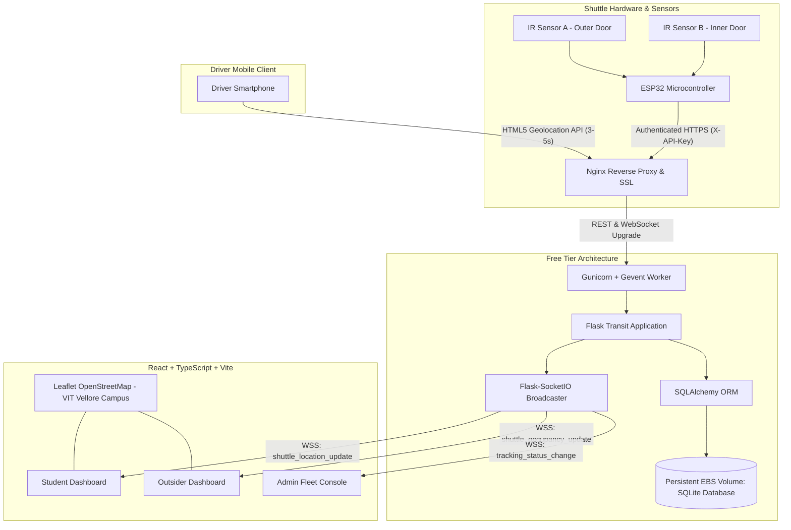

# System Architecture & Technical Specifications
## VIT Shuttle — Smart Campus Transit System (VIT Vellore)

---

## 1. End-to-End System Architecture

---

## 2. Core Data Pipelines

### A. Driver Mobile GPS Telemetry Flow
1. Driver authenticates with assigned credentials on mobile browser.
2. Driver clicks **"START MOBILE GPS TRACKING"**.
3. Browser requests high-accuracy GPS coordinates via `navigator.geolocation.watchPosition` (`enableHighAccuracy: true`, `timeout: 10000ms`, `maximumAge: 3000ms`).
4. Updates throttled to every 3 seconds to preserve driver battery and cellular bandwidth.
5. Coordinates posted to `/api/driver/tracking/location` with JWT token.
6. Backend verifies:
   - Driver identity and assigned shuttle ID.
   - Coordinate bounds (valid latitude between -90 and 90, longitude between -180 and 180).
   - Campus boundary proximity check (VIT Vellore geofence).
   - Accuracy threshold (< 200 meters).
7. Backend updates `Shuttle` model (`latest_latitude`, `latest_longitude`, `gps_accuracy`, `last_gps_update`, `is_tracking_active = True`).
8. Record persisted to `LocationHistory` table.
9. Flask-SocketIO broadcasts event `shuttle_location_update` to all connected browser clients.
10. Leaflet map markers animate to new coordinates with color-coded occupancy badges.

### B. ESP32 Directional Passenger Counting Flow
1. Directional Dual IR Sensor State Machine:
   - Doorway equipped with Sensor A (outer) and Sensor B (inner).
   - **Entry Detection:** Beam A broken $\rightarrow$ Beam B broken within 2000ms $\rightarrow$ Passenger entered (+1).
   - **Exit Detection:** Beam B broken $\rightarrow$ Beam A broken within 2000ms $\rightarrow$ Passenger exited (-1).
2. Debounce window (150ms) suppresses optical noise and body edge flutter.
3. Microcontroller saves updated count and monotonic sequence number to non-volatile flash (NVS via `Preferences.h`).
4. ESP32 sends authenticated HTTP POST to `/api/iot/shuttles/{shuttle_id}/occupancy` with `X-API-Key` header.
5. Backend verifies:
   - Device API key hash matches `IoTDevice.api_key_hash`.
   - Device is authorized for targeted shuttle ID.
   - Sequence number is greater than `device.last_sequence_number` (rejects replay attacks).
6. Backend computes:
   - `available_seats = max(0, capacity - count)`
   - `occupancy_percentage = round((count / capacity) * 100, 1)`
   - `is_full = count >= capacity`
7. Record inserted into `OccupancyEvent` table.
8. Flask-SocketIO broadcasts event `shuttle_occupancy_update`.
9. Connected student and visitor dashboards update seat counters and progress bars in real-time.

---

## 3. Server-Side Role-Based Authorization (RBAC) Matrix

| Endpoint | Method | Driver | Student | Outsider | Admin | Unauthenticated |
| :--- | :---: | :---: | :---: | :---: | :---: | :---: |
| `/api/shuttles` (Fleet List) | GET | ✓ | ✓ | ✓ | ✓ | ✓ |
| `/api/shuttles/campus-meta` | GET | ✓ | ✓ | ✓ | ✓ | ✓ |
| `/api/driver/my-shuttle` | GET | ✓ | ✗ (403) | ✗ (403) | ✓ | ✗ (401) |
| `/api/driver/tracking/start` | POST | ✓ | ✗ (403) | ✗ (403) | ✓ | ✗ (401) |
| `/api/driver/tracking/location`| POST | ✓ | ✗ (403) | ✗ (403) | ✓ | ✗ (401) |
| `/api/iot/shuttles/{id}/occupancy`| POST | ✗ | ✗ | ✗ | ✗ | ✓ (IoT API Key) |
| `/api/admin/drivers` | POST | ✗ (403) | ✗ (403) | ✗ (403) | ✓ | ✗ (401) |
| `/api/admin/shuttles/{id}/correct-count` | POST | ✗ (403) | ✗ (403) | ✗ (403) | ✓ | ✗ (401) |
| `/api/admin/audit-logs` | GET | ✗ (403) | ✗ (403) | ✗ (403) | ✓ | ✗ (401) |

---

## 4. VIT Vellore Campus Geofence Specifications

- **Campus Center:** `Latitude 12.9692° N, Longitude 79.1559° E`
- **Initial Map Zoom:** 16 (Campus view)
- **Bounding Box:**
  - Latitude: `12.9620° N` to `12.9780° N`
  - Longitude: `79.1480° E` to `79.1680° E`
- **Campus Key Stops:**
  1. Main Entrance & Katpadi Connector (`12.9648, 79.1645`)
  2. Technology Tower [TT] (`12.9708, 79.1594`)
  3. Silver Jubilee Tower [SJT] (`12.9712, 79.1638`)
  4. Men's Hostels Blocks A-Q (`12.9745, 79.1600`)
  5. Ladies Hostels Blocks (`12.9715, 79.1660`)
  6. Anna Auditorium & Foodys (`12.9692, 79.1565`)
